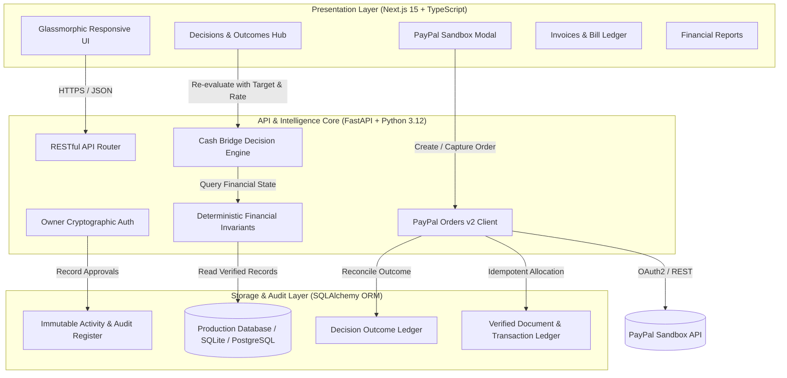

# LedgerAI — Autonomous Financial Intelligence & Verified PayPal Settlement Engine

[](https://opensource.org/licenses/MIT)
[](https://www.python.org/)
[](https://fastapi.tiangolo.com/)
[](https://nextjs.org/)
[](https://www.typescriptlang.org/)
[](https://tailwindcss.com/)
[](https://developer.paypal.com/)
[]()

> **PayPal AI Hackathon 2026 Flagship Submission**  
> *Record what happened. Understand the health of the business. Know what needs attention. Execute verified actions — with the owner strictly in control.*

---

## 🌐 Live Production Deployments

| Resource | URL | Status | Description |
|:---|:---|:---|:---|
| **Web Application** | [https://ledger-ai-ruby.vercel.app](https://ledger-ai-ruby.vercel.app) |  | Production Next.js 15 App with Dark/Light glassmorphism |
| **Backend REST API** | [https://ledgerai-backend-0ive.onrender.com](https://ledgerai-backend-0ive.onrender.com) |  | High-performance FastAPI backend engine |
| **Interactive API Docs** | [https://ledgerai-backend-0ive.onrender.com/docs](https://ledgerai-backend-0ive.onrender.com/docs) |  | Interactive API exploration & schema documentation |
| **GitHub Repository** | [https://github.com/rachit101-cell/LedgerAI](https://github.com/rachit101-cell/LedgerAI) |  | Verified open-source codebase & test suites |

---

## 📌 Table of Contents
1. [Executive Summary & Problem Statement](#-1-executive-summary--problem-statement)
2. [Core Innovations & Architecture Pillars](#-2-core-innovations--architecture-pillars)
3. [The Cash Bridge Engine & PayPal Integration](#-3-the-cash-bridge-engine--paypal-integration)
4. [System Architecture](#-4-system-architecture)
5. [Project Directory Layout](#-5-project-directory-layout)
6. [Quickstart: Local Installation](#-6-quickstart-local-installation)
7. [Automated Verification & Test Suite](#-7-automated-verification--test-suite)
8. [Interactive Hackathon Demo Walkthrough](#-8-interactive-hackathon-demo-walkthrough)
9. [Authoritative Security & AI Safety Guardrails](#-9-authoritative-security--ai-safety-guardrails)
10. [License & Acknowledgments](#-10-license--acknowledgments)

---

## 💡 1. Executive Summary & Problem Statement

Small and medium enterprises (SMEs, distributors, wholesalers, and retail merchants) face an existential paradox: **they are profitable on paper, but chronically cash-starved in reality**.

- **The Problem:** Customers delay invoice settlements for weeks, while supplier bills, warehousing fees, and logistics obligations remain inflexible. Manual invoice chasing damages client relationships, traditional factoring firms charge predatory rates (10–25%), and generic "AI accounting chatbots" hallucinate numbers and hallucinate balances, posing unacceptable financial liability.
- **The LedgerAI Solution:** A dual-engine financial operating system combining:
  1. **A Zero-Hallucination Deterministic Financial Core:** Python-powered exact decimal accounting where balances, cash flows, and shortfall projections derive strictly from verified ledger entries. AI is banned from computing arithmetic.
  2. **An Autonomous Cash Bridge Engine:** When a supplier bill threatens an overdraft, LedgerAI calculates dynamic early-settlement discount structures (Prompt Cash 2.0%, Fast Cash 3.5%, Urgent Bridge 5.0%), presents side-by-side trade-off evaluations, secures cryptographic owner authorization (SHA-256), and collects accelerated funds via the **genuine PayPal Orders v2 Sandbox API**.
  3. **Closed-Loop Reconciliation & Outcome Ledger:** Webhook-backed server-side payment capture updates balances idempotently and logs predicted vs. actual financial impact in a permanent Decision Outcome Ledger.

---

## 🏛️ 2. Core Innovations & Architecture Pillars

| Capability | Technical Mechanism | Business Value |
|:---|:---|:---|
| **Deterministic Accounting Core** | Server-side Python exact `Decimal` arithmetic with `ROUND_HALF_UP`. Outstanding balances = `total - valid_allocations`. | Zero hallucination risk. Financial statements are mathematically infallible and audit-ready. |
| **Autonomous Cash Bridge Engine** | Continuous 14-day rolling cash deficit scanning against upcoming supplier payables. | Proactively identifies liquidity shortfalls before they cascade into supply-chain halts. |
| **Dynamic Early Settlement Offers** | Configurable prompt-settlement rate engine (2.0%, 3.5%, 5.0%) dynamically modeled against customer receivables. | Accelerates incoming liquidity within 24–48 hours at a fraction of factoring costs. |
| **Owner-in-the-Loop Governance** | Cryptographic action drafts signed by a SHA-256 hash of recipient, document, and monetary payload. | Absolute owner control. AI cannot execute payments, send messages, or modify terms without physical approval. |
| **Server-Verified PayPal Capture** | PayPal REST Orders v2 workflow with strict server-side verification. | Browser redirects alone never settle invoices. Double-credit prevention via provider order ID deduplication. |
| **Decision Outcome Ledger** | Permanent ledger tracking decisions from recommendation to verified execution with variance auditing. | Continuous system accountability: tracks `actual_impact - estimated_impact` across every financial intervention. |

---

## ⚡ 3. The Cash Bridge Engine & PayPal Integration

### How Cash Bridge Solves the Cash Deficit
When **Apex Enterprises** has **₹45,000.00** recorded cash on hand but faces a **₹65,000.00** supplier bill (`BILL-2026-0108` to Sunrise Distributors), an immediate **-₹20,000.00** liquidity deficit is projected.

LedgerAI scans verified receivables and formulates 3 distinct, actionable strategies:

```
[Strategy 1: Full-Face Collection]
  Customer pays full balance (0% discount) -> Recovers 100% face value, but collection timing remains uncertain.

[Strategy 2: Cash Bridge Early-Settlement Offer (Recommended)]
  Customer receives an attractive prompt-settlement incentive to remit funds immediately:
  - 2.0% Prompt Cash:  Customer saves ₹700.00  -> Apex recovers ₹34,300.00 net within 24h
  - 3.5% Fast Cash:    Customer saves ₹1,225.00 -> Apex recovers ₹33,775.00 net within 24h
  - 5.0% Urgent Bridge: Customer saves ₹1,750.00 -> Apex recovers ₹33,250.00 net within 24h
  * Supplier Obligation is paid 100% in full without requesting humiliating extensions!

[Strategy 3: Supplier Term Rescheduling]
  Negotiate a 14-day extension with supplier -> Avoids customer discount but incurs supplier relationship strain.
```

### Server-Side PayPal Orders v2 Architecture
```
  [ Merchant / Owner ]
          │ (1) Reviews & Approves 2.0% Cash Bridge Offer
          ▼
   [ LedgerAI Core ] ─────── (2) SHA-256 Cryptographic Hash Stored
          │
          │ (3) Create Order Request (v2/checkout/orders)
          ▼
    [ PayPal API ] ───────── (4) Returns Order ID & Approve Link
          │
  [ Customer Checkout ] ─── (5) Authorizes Payment in PayPal Sandbox
          │
          ▼ (Redirect)
   [ LedgerAI Core ] ─────── (6) Server-Side Orders Capture (POST v2/checkout/orders/{id}/capture)
          │
          ├─► [ Customer Ledger ] ── Marks Invoice Paid (Net ₹34,300 + ₹700 Disc)
          ├─► [ Cash Account ]    ── Records Inflow (+₹34,300.00)
          └─► [ Outcome Ledger ]  ── Variance ₹0.00, Status VERIFIED_SUCCESSFUL
```

---

## 🏗️ 4. System Architecture



---

## 📂 5. Project Directory Layout

```
ledger_ai/
├── README.md                           # Main Project Overview & Architecture Guide
├── LICENSE                             # MIT Open-Source License
├── .env.example                        # Root environment variables template
├── ledgerai.db                         # Local SQLite development database (auto-seeded)
│
├── backend/                            # High-Performance FastAPI Backend
│   ├── README.md                       # Backend Architecture & Testing Documentation
│   ├── requirements.txt                # Python dependencies (pinned versions)
│   ├── run_server.py                   # Development server runner with port fallback
│   ├── pytest.ini                      # Pytest runner configuration
│   ├── app/
│   │   ├── main.py                     # FastAPI application factory, CORS & routers
│   │   ├── config.py                   # Pydantic Settings & environment validation
│   │   ├── database.py                 # SQLAlchemy session engine & connection pooling
│   │   ├── models.py                   # SQLAlchemy ORM models (Documents, Decisions, Audit)
│   │   ├── schemas.py                  # Pydantic v2 validation contracts & DTOs
│   │   ├── auth.py                     # Cryptographic signature & role validation
│   │   └── services/
│   │       ├── decision_service.py     # Cash Bridge Decision Engine (deterministic logic)
│   │       ├── financial.py            # Financial summary & invariant calculations
│   │       ├── paypal_service.py       # PayPal REST Orders v2 API client & reconciliation
│   │       ├── ai_assistant.py         # Grounded AI assistant with allowlisted tools
│   │       └── seed_data.py            # Apex Enterprises deterministic seed records
│   └── tests/                          # 33 Automated Unit & Integration Tests
│       ├── test_financial_invariants.py
│       ├── test_cash_bridge_engine.py
│       ├── test_decision_engine.py
│       └── test_api_endpoints.py
│
└── frontend/                           # Next.js 15 Web Workspace
    ├── README.md                       # Frontend Components & State Documentation
    ├── package.json                    # Node dependencies & build scripts
    ├── tsconfig.json                   # TypeScript compiler configuration
    ├── next.config.ts                  # Next.js runtime configuration
    ├── types.ts                        # Shared TypeScript interfaces & types
    ├── app/
    │   ├── layout.tsx                  # Root responsive layout & providers
    │   ├── page.tsx                    # Main multi-view dashboard orchestrator
    │   └── globals.css                 # Tailwind CSS 4 design tokens & glassmorphism
    ├── components/
    │   ├── Navbar.tsx                  # Top status bar with live cash indicators
    │   ├── Sidebar.tsx                 # Navigation drawer & workspace switcher
    │   ├── Overview.tsx                # Cash runway, receivables, and deficit banners
    │   ├── DecisionsView.tsx           # Cash Bridge comparison engine & slider simulations
    │   ├── InvoicesView.tsx            # Sales receivables & supplier obligations table
    │   ├── FinancialReportsView.tsx    # P&L, balance breakdown, and cash movement metrics
    │   ├── PayPalCheckoutModal.tsx     # Embedded PayPal checkout & status polling
    │   ├── ActionApprovalModal.tsx     # SHA-256 cryptographic owner authorization modal
    │   └── ChatAssistant.tsx           # Grounded natural-language query interface
    └── lib/
        └── api.ts                      # Resilient fetch client with backend fallback
```

---

## 🚀 6. Quickstart: Local Installation

### Prerequisites
- **Python:** 3.10 or higher (Python 3.12 recommended)
- **Node.js:** 18.0 or higher
- **Package Manager:** npm or pnpm

### 1. Backend Setup
```bash
# Clone the repository
git clone https://github.com/rachit101-cell/LedgerAI.git
cd LedgerAI/backend

# Create virtual environment
python -m venv venv

# Activate virtual environment
# Windows (PowerShell):
.\venv\Scripts\Activate.ps1
# Linux / macOS:
source venv/bin/activate

# Install dependencies
pip install -r requirements.txt

# (Optional) Setup environment variables
cp .env.example .env

# Launch the FastAPI server
python run_server.py
```
*The backend API will start on `http://localhost:8000`. On first initialization, it automatically provisions and seeds `ledgerai.db` with the canonical Apex Enterprises dataset.*

### 2. Frontend Setup
```bash
# Open a new terminal from repository root
cd LedgerAI/frontend

# Install dependencies
npm install

# Launch Next.js development server
npm run dev
```
*Open [http://localhost:3000](http://localhost:3000) in your browser to access the workspace.*

---

## 🧪 7. Automated Verification & Test Suite

LedgerAI enforces a strict test-driven development protocol. All accounting rules, financial invariants, and security controls are validated via **33 automated test cases**:

```bash
cd backend
python -m pytest -v
```

### Test Suite Architecture
- **Financial Invariants (`test_financial_invariants.py` — 7 tests):**
  - Validates exact decimal arithmetic with zero float imprecision.
  - Verifies invoice balance calculation: `outstanding = total - sum(allocations)`.
  - Asserts cash shortfall math: `shortfall = max(0, obligations - recorded_cash)`.
  - Confirms rejection of unverified/fabricated PayPal order IDs.
  - Proves idempotent double-payment prevention.
  - Verifies SHA-256 payload tampering detection.
- **API Endpoints & Isolation (`test_api_endpoints.py` — 15 tests):**
  - Multi-tenant workspace data boundary enforcement.
  - Strict rejection of spoofed browser authorization headers.
  - Cryptographic verification of PayPal webhook payloads.
  - Resilient error handling across malformed financial payloads.
- **Decision Engine & Cash Bridge (`test_decision_engine.py` & `test_cash_bridge_engine.py` — 11 tests):**
  - Deterministic shortfall detection and option synthesis.
  - Absence of financial data produces explicit warnings instead of hallucinations.
  - Accurate early-settlement discount scaling (2.0%, 3.5%, 5.0%).
  - 100% full supplier payment preservation invariant.
  - Cryptographic action draft binding and approval state transitions.
  - Decision Outcome Ledger variance calculation (`actual - predicted = 0`).

---

## 🎬 8. Interactive Hackathon Demo Walkthrough

Follow this 2-minute walkthrough to experience the entire closed-loop workflow:

```
[ Step 1: Discover the Deficit ]
  1. Open https://ledger-ai-ruby.vercel.app/
  2. Notice Apex Enterprises has ₹45,000.00 cash on hand.
  3. A high-priority banner flags an upcoming ₹65,000.00 bill (Sunrise Distributors),
     causing a projected cash deficit of -₹20,000.00.

[ Step 2: Compare Cash Bridge Options ]
  1. Click "Compare Decision Options" on the shortfall banner.
  2. View Strategy #1 (Full Collection), Strategy #2 (Early Settlement Bridge),
     and Strategy #3 (Supplier Rescheduling).
  3. Click "2.0% Prompt Cash", "3.5% Fast Cash", or "5.0% Urgent Bridge" to dynamically
     simulate accelerated cash inflows and net balances for Sharma Traders or Mehta Supermart.

[ Step 3: Authorize Action Draft ]
  1. Select Strategy #2 and click "Review & Authorize Link".
  2. Inspect the cryptographic Action Draft details (Customer, Balance, Discount, Net Cash).
  3. Review the SHA-256 verification hash and click "Approve & Dispatch".

[ Step 4: Live PayPal Sandbox Payment & Reconciliation ]
  1. The PayPal Checkout Modal opens with an active PayPal Sandbox Order.
  2. Click "Open PayPal Sandbox Hosted Checkout" (or simulate customer payment).
  3. Enter PayPal Sandbox personal credentials to complete payment.
  4. The modal updates with live server confirmation:
     "Server Verified: Capture COMPLETED on PayPal Sandbox".

[ Step 5: Verify Ledger Invariants & Audit Ledger ]
  1. Return to Dashboard: Recorded Cash increases by the net collected amount!
  2. The shortfall alert clears: supplier obligations can now be satisfied 100% on time.
  3. Invoices view shows the customer invoice updated to "PAID" with exact discount recognized.
  4. Decision Outcome Ledger confirms: Predicted = ₹34,300, Actual = ₹34,300, Variance = ₹0.00.
```

---

## 🛡️ 9. Authoritative Security & AI Safety Guardrails

LedgerAI was engineered from day one under strict financial and AI safety principles:

1. **Zero AI Financial Arithmetic:** Language models are strictly barred from calculating totals, subtracting expenses, or determining tax liabilities. All numbers are computed by deterministic Python services.
2. **Cryptographic Action Binding:** Every action draft (payment link, email notice, payment term offer) is hashed with SHA-256. If a single digit is altered after owner review, the authorization is automatically invalidated.
3. **Server-Side Trust Model:** Browser clients are considered untrusted. A client redirect or URL query parameter like `?paypal_success=true` **never** marks an invoice paid. Only authenticated, server-to-server calls to the PayPal REST API can trigger a state change.
4. **Idempotency by Design:** Every PayPal order capture is recorded against an immutable provider transaction reference. Replaying the same webhook or API call produces an identical idempotent result without duplicate credits.

---

## 📄 10. License & Acknowledgments

This project is licensed under the **MIT License** — see the [LICENSE](LICENSE) file for complete details.

### Acknowledgments
- **PayPal Developer Platform:** For the comprehensive Orders v2 REST API and sandbox infrastructure.
- **FastAPI & Next.js Communities:** For providing the world's most performant, ergonomic full-stack foundation.
- **The PayPal AI Hackathon 2026 Organizers:** For inspiring financial technology innovations that empower small business owners worldwide.

---

<div align="center">
  <sub>Built with precision and care for the PayPal AI Hackathon 2026.</sub>
</div>
